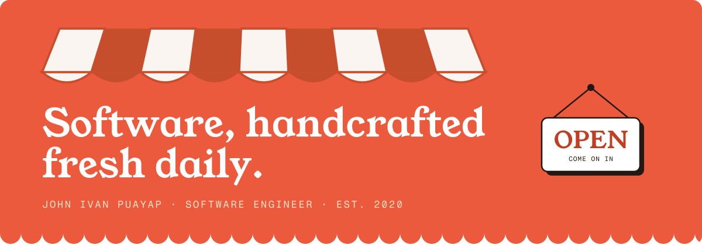

I'm John Ivan, a software engineer who builds things because I wonder if I can. This is the GitHub branch of the shop; the full storefront is at **[johnivanpuayap.github.io](https://johnivanpuayap.github.io)**.

## The Build Log

CAREER, CHRONOLOGICALLY — LIKE COMMIT HISTORY, BUT FOR LIFE

- **Software Engineer** · Ereflect · APR 2025 — PRESENT Shipping features across multiple products in Angular and Ionic, reviewing code, and nudging the team toward better practices.
- **Summer Intern** · Alliance Software Inc · JUN — AUG 2024 Led backend development on a helpdesk system: database design, SQL, background services.
- **Freelance Web Developer** · Various clients · 2020 — 2023 Landing pages and small-business sites, built and maintained.
- **BS Computer Science** · Cebu Institute of Technology – University · 2022 — 2025

**Certified:** PhilNITS FE Passer (May 2024) · TOPCIT Level 3, twice (Apr & Nov 2024)

## The Toolboard

EVERY TOOL ON THIS BOARD HAS BEEN USED IN ANGER

**Languages** 

**Frameworks** 

**Data & Tools** 

## The Ledger

## The Front Desk

HIRING, COMMISSIONING A BUILD, OR JUST CURIOUS — SAY HI. I READ EVERYTHING.

